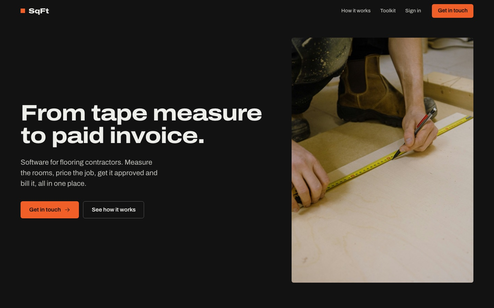

# SqFt

**From tape measure to paid invoice.**

Software for flooring contractors. Measure the rooms, price the job, get it signed, get paid.

[sqft.dev](https://www.sqft.dev)



## what it does

- **measure**: room-by-room site measures, per location, per customer
- **quote**: estimates built from the measure, with markup, revisions and one-link customer approval
- **bill**: progress invoices, proration, card + ACH checkout through Stripe Connect
- **sync**: one-way push to QuickBooks Online
- **schedule**: crew calendar, backlog of unscheduled jobs, mobile day view for installers
- **run it**: multi-tenant orgs, admin / lead / crew roles, super-admin console, PDF + email out

## stack

Next.js 16 · React 19 · Prisma 7 / Postgres (Neon) · Auth.js · Stripe Connect · QuickBooks Online · Resend · react-pdf · TanStack Query · Tailwind 4 · Vitest · Playwright · Vercel

## run

```sh
npm install
cp .env.example .env    # add DATABASE_URL
npm run migrate:dev
npm run seed:dev
npm run dev
```

`npm test` · `npm run test:e2e` · `npm run lint:ci` · `npm run typecheck`

## read next

- [CONTEXT.md](CONTEXT.md): domain glossary, the estimate math, lifecycles
- [AGENTS.md](AGENTS.md): codebase map and gotchas
- [docs/design-system.md](docs/design-system.md): tokens, type, primitives
- [`www/`](www): the marketing site
